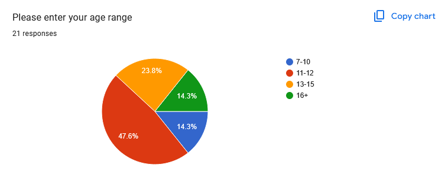
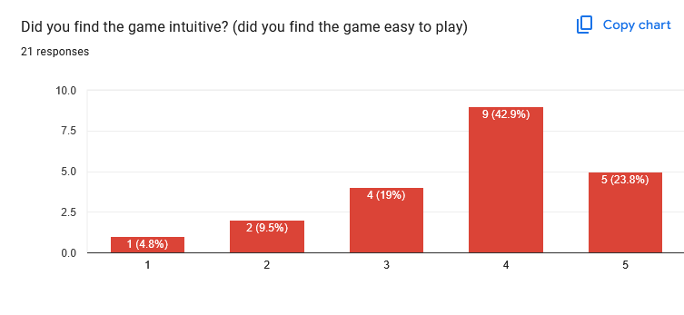
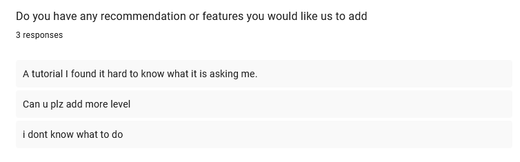
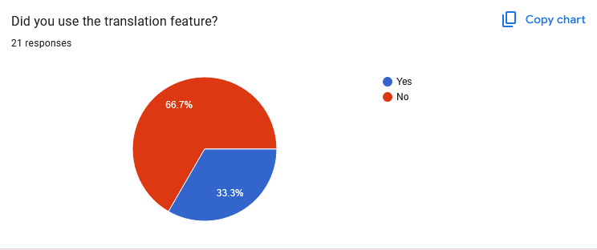
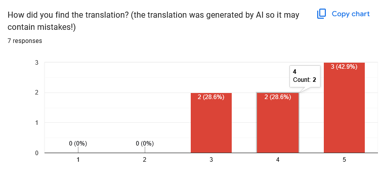

# Root Cause: Mars Outpost Troubleshooter

**Something is wrong at the Mars base and it is your job to find out what it is**

Root Cause is a browser game for kids aged 7–12. Players are flight controllers at Suhail Base in Gale Crater, Mars. Each case starts with an alarm. Looking at the readings is free, but every test costs crew hours. 
To win, players must think like scientists: predict, test, rule things out and fix the real cause.

Built for the 2026 NASA Space Apps Challenge : [Build a Junior Astronaut Mission Trainer](https://www.spaceappschallenge.org/2026/challenges/junior-astronaut-mission-trainer/).

**Play it:** [Root-Cause](https://ahmedalnidawi.github.io/Root-Cause/)
We made it accessible by having to play it easily by clicking the link above, or download the code and open index.html.

---

## How a case works

1. **Alarm.** Something is wrong. Press the master alarm to start.
2. **Quick decision.** A trade-off with no free option. For example: switch the lab off to save battery (and lose a sol of science), or keep it running (and risk the greenhouse heater being cut tonight).
3. **Look at the readings.** Free charts of the outpost's systems with a dotted "normal day" line to compare against.
4. **Run tests.** Each test costs crew hours. Before it runs, the player predicts the result.
5. **Ask Mission Control** if stuck it costs 2 crew hours, because messages take 4 to 24 minutes each way between Earth and Mars.
6. **Call the root cause.** A wrong call costs 2 hours.
7. **Build the chain.** Put the cause-and-effect steps in order. One card is fake, and a wrong card costs an hour.
8. **Fix it.** Some fixes only treat the symptom. Only fixing the cause closes the case.
9. **Real mission.** Each case ends with the true NASA story it is based on, with a link.

Stars are awarded for fixing the problem, using few tests, and predicting every test correctly. The root cause is picked at random from 2–3 possibilities each time, so replaying a case can lead to a different answer.

## The six cases

| # | Case | System | Real NASA story |
|---|------|--------|-----------------|
| 1 | Dim Day (tutorial) | Power | Dust slowly covered InSight's solar panels (2018–2022) |
| 2 | Cold Lettuce | Food and power | A dust storm put InSight into safe mode (January 2022) |
| 3 | Stuffy Air | Life support (CO₂) | Apollo 13's CO₂ filter fix (1970) |
| 4 | Oxygen Alarm | Life support (oxygen) | The ISS ammonia false alarm (January 2015) |
| 5 | Slow Leak | Life support (air pressure) | The ISS slow air leak hunt (2020) |
| 6 | Storm Incoming | Radiation shielding | The solar storm that hit Mars (May 20, 2024) |

## How it fits the challenge

- **Life support, radiation shielding, power and food:** each has at least one case, and cases show how the systems depend on each other. A weak battery leads to the heater being cut, the greenhouse freezing, and the lettuce stopping growing.
- **Communication delay:** Ask Mission Control costs crew hours because of the real Earth–Mars message delay.
- **No free choices:** tests, wrong calls, wrong chain cards, wrong fixes and asking for help all cost crew hours. Every quick decision has a downside, this design is done on purpose to challenge the player.

- **Replayability:** random root causes, plus stars to improve on.
- **Plain language:** short sentences. Words like *sol*, *ppm*, *kPa* and *ohms* are explained next to the chart where they appear.
- **Low barrier:** runs in any browser, with no download or sign up is needed.
- **Four languages:** English, Arabic, French and Spanish.

## NASA data used

All of this is also listed in the game under **"NASA data used"** on the title screen.

| data | what we used | where it appears | source |
|------|--------------|------------------|--------|
| InSight lander solar power | About 5,000 Wh per sol after landing (2018), cut by dust to about 500 by spring 2022 | Dim Day: "InSight's solar power" reading | [NASA / JPL](https://www.nasa.gov/missions/insight/nasas-insight-still-hunting-marsquakes-as-power-levels-diminish) |
| Curiosity rover REMS weather station | Gale Crater, sol 4189 (May 19, 2024): low −68 °C, high −5 °C, 861 Pa. Sol 4190 (May 20, 2024): low −69 °C, high −3 °C, 860 Pa | "Air outside" reading in every case | [NASA / JPL, Centro de Astrobiología](https://mars.nasa.gov/msl/mission/weather/) |
| DONKI space weather database | CME 2024-05-20T05:36:00-CME-001, from Sun region 13664, about 2,678 km/s | Storm Incoming: Mission Control's space weather alert | [NASA CCMC DONKI](https://kauai.ccmc.gsfc.nasa.gov/DONKI/) |
| Curiosity rover RAD radiation detector | 8,100 micrograys on May 20, 2024 (about 30 chest X-rays), against about 180–225 on a normal sol | Storm Incoming: "Radiation dose" reading | [NASA](https://www.nasa.gov/solar-system/planets/mars/nasa-watches-mars-light-up-during-epic-solar-storm) |
| Earth–Mars message delay | 4 to 24 minutes each way | Ask Mission Control | [NASA](https://www.nasa.gov/centers-and-facilities/goddard/space-communications-7-things-you-need-to-know/) |
| Real mission stories | Apollo 13, InSight, ISS | "Real mission" box at the end of each case | Linked NASA pages ([Apollo 13](https://www.nasa.gov/wp-content/uploads/static/history/SP-350/ch-13-4.html), [InSight 2022](https://www.nasa.gov/solar-system/nasas-insight-sees-power-levels-stabilize-after-dust-storm/), [ISS 2015](https://www.nasa.gov/blogs/stationreport/2015/01/14/iss-daily-summary-report-01-14-15/), [ISS 2020](https://www.nasa.gov/blogs/spacestation/2020/08/20/crew-spending-weekend-in-stations-russian-segment/)) |

This is archived data stored in the game, not a live feed. The outpost's own readings (battery, greenhouse, CO₂ and so on) come from a simple simulation in :
`js/sim.js`
 so each case behaves in a consistent, realistic way.
## Playtesting

21 people played the game and filled in a feedback form.
## Playtesting

21 people played Root Cause and filled in a feedback form.

- **Ages:** 13 of 21 players (62%) were in our target age of 7–12. The rest were 13 or older.
- **Easy to play:** 14 of 21 (67%) rated the game 4 or 5 out of 5 for being easy to play (average 3.7).
- **Translations:** 7 players played in another language. 5 of those 7 rated the translation 4 or 5 out of 5, and nobody rated it below 3.
- **Suggestions:** 2 of the 3 written suggestions asked for clearer instructions at the start, and 1 asked for more levels.

**What we changed:** after this feedback we made the start clearer. Case 1 walks players through each step, Ask Mission Control gives a hint when someone is stuck, and words like *sol* and *kPa* are explained on screen.











## How it's built

Plain HTML, CSS and JavaScript, with no frameworks, libraries or build step. Sounds are generated in code with Web Audio API.

```
index.html          screens and layout
css/style.css       mission control look and visualss
js/cases.js         the six cases: readings, tests, causes, fixes, costs
js/sim.js           48-hour outpost simulation and chart data
js/game.js          game logic
js/graph.js         chart drawing
js/sound.js         sound effects
js/lang/*.js        all game text in English, Arabic, French and Spanish
```


## Use of SI

We used **Claude (Anthropic)** explicitily for:

- **Translations:** the Arabic, French and Spanish versions of all game text. The game says this on the title screen.
- **One bug fix:** a logic error in the chart drawing (`js/graph.js`) which we could not fix by ourselves..
- **Review and testing:** Claude reviewed the game against the challenge brief, found bugs, tested every case in every language, Our team built these changes ourselves.


## Team
Comic Drift:
Coder and Programmer: Ahmed Al Nidawi, Obaid Alzaabi
Researcher: Mohamed Al Remeithi

